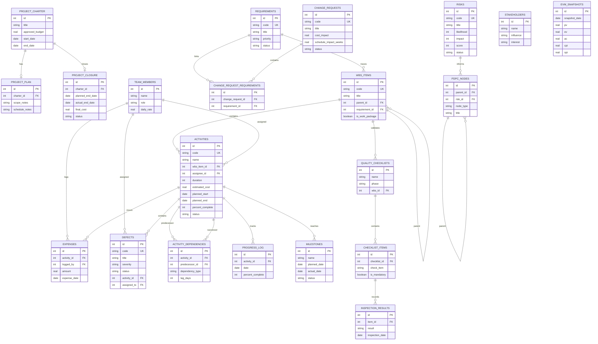

# Smart Healthcare PM System — ER Diagram

> Concise overview of the main database entities and their relationships.  
> The complete implementation is defined in [`schema.sql`](./schema.sql).

## Supporting tables

- `settings` stores status-date and threshold configuration.
- `audit_log` stores important create, update, delete, and approval events.
