# Smart Healthcare PM System — Compact ER Diagram

> Compact database overview. The complete schema is defined in
> [`schema.sql`](./schema.sql).

```mermaid
erDiagram
    PROJECT_CHARTER ||--o| PROJECT_PLAN : has
    PROJECT_CHARTER ||--o| PROJECT_CLOSURE : closes
    REQUIREMENTS ||--o{ WBS_ITEMS : traces
    CHANGE_REQUESTS ||--o{ CHANGE_REQUEST_REQUIREMENTS : contains
    REQUIREMENTS ||--o{ CHANGE_REQUEST_REQUIREMENTS : requested_for
    WBS_ITEMS ||--o{ WBS_ITEMS : parent
    WBS_ITEMS ||--o{ ACTIVITIES : contains
    TEAM_MEMBERS ||--o{ ACTIVITIES : assigned
    ACTIVITIES ||--o{ ACTIVITY_DEPENDENCIES : depends_on
    ACTIVITIES ||--o{ EXPENSES : incurs
    ACTIVITIES ||--o{ PROGRESS_LOG : tracks
    ACTIVITIES ||--o{ MILESTONE_ACTIVITIES : links
    MILESTONES ||--o{ MILESTONE_ACTIVITIES : includes
    ACTIVITIES ||--o{ DEFECTS : contains
    TEAM_MEMBERS ||--o{ RESPONSIBILITIES : owns
    TEAM_MEMBERS ||--o{ DEFECTS : assigned
    QUALITY_CHECKLISTS ||--o{ CHECKLIST_ITEMS : contains
    CHECKLIST_ITEMS ||--o{ INSPECTION_RESULTS : records
    WBS_ITEMS ||--o{ QUALITY_CHECKLISTS : validates
    RISKS ||--o{ PDPC_ITEMS : informs
    PDPC_ITEMS ||--o{ PDPC_ITEMS : parent

    PROJECT_CHARTER {
        int id PK
        string title
        date start_date
        date end_date
        real budget
    }
    PROJECT_PLAN {
        int id PK
        int charter_id FK
    }
    PROJECT_CLOSURE {
        int id PK
        int charter_id FK
        string status
    }
    TEAM_MEMBERS {
        int id PK
        string name
        string role
    }
    STAKEHOLDERS {
        int id PK
        string name
        string influence
        string interest
    }
    REQUIREMENTS {
        int id PK
        string code UK
        string title
        string status
    }
    CHANGE_REQUESTS {
        int id PK
        string code UK
        string status
        real cost_impact
    }
    CHANGE_REQUEST_REQUIREMENTS {
        int id PK
        int change_request_id FK
        int requirement_id FK
    }
    WBS_ITEMS {
        int id PK
        string code UK
        string title
        int parent_id FK
    }
    ACTIVITIES {
        int id PK
        string code UK
        int wbs_item_id FK
        int assignee_id FK
        string status
    }
    ACTIVITY_DEPENDENCIES {
        int id PK
        int activity_id FK
        int predecessor_id FK
    }
    MILESTONES {
        int id PK
        string name
        date planned_date
    }
    MILESTONE_ACTIVITIES {
        int id PK
        int milestone_id FK
        int activity_id FK
    }
    RESPONSIBILITIES {
        int id PK
        int team_member_id FK
        string deliverable
        string responsibility_type
    }
    EXPENSES {
        int id PK
        int activity_id FK
        real amount
    }
    PROGRESS_LOG {
        int id PK
        int activity_id FK
        int percent_complete
    }
    EVM_SNAPSHOTS {
        int id PK
        date snapshot_date
        real pv
        real ev
        real ac
    }
    DEFECTS {
        int id PK
        string code UK
        int activity_id FK
        int wbs_item_id FK
        int assignee_id FK
        string severity
        string status
    }
    QUALITY_CHECKLISTS {
        int id PK
        string name
        int wbs_item_id FK
    }
    CHECKLIST_ITEMS {
        int id PK
        int checklist_id FK
        string description
    }
    INSPECTION_RESULTS {
        int id PK
        int checklist_item_id FK
        string result
    }
    RISKS {
        int id PK
        string code UK
        int likelihood
        int impact
        string status
    }
    PDPC_ITEMS {
        int id PK
        int parent_id FK
        int risk_id FK
        string node_type
    }
    SETTINGS {
        int id PK
        string key UK
        string value
    }
    AUDIT_LOG {
        int id PK
        string entity_type
        string action
        date created_at
    }
```

The diagram intentionally omits non-key implementation columns so it remains
readable at normal page zoom while still covering the schema's entities and
foreign-key structure.
