# Database Entity-Relationship (ER) Diagram

> **Smart Healthcare Project Management and Monitoring System**  
> Course: CSE-494 Software Project Management (Mid-Term Lab)  
> Database Engine: SQLite3 (with Foreign Key constraints enabled and WAL mode)

---

## 1. Complete Mermaid ER Diagram

```mermaid
erDiagram
    PROJECT_CHARTER ||--o| PROJECT_PLAN : authorizes
    PROJECT_CHARTER ||--o| PROJECT_CLOSURE : closes

    REQUIREMENTS ||--o{ WBS_ITEMS : "traced into"
    CHANGE_REQUESTS ||--o{ CHANGE_REQUEST_REQUIREMENTS : includes
    REQUIREMENTS ||--o{ CHANGE_REQUEST_REQUIREMENTS : "requested in"
    
    WBS_ITEMS ||--o{ WBS_ITEMS : "decomposed into (parent_id)"
    WBS_ITEMS ||--o{ ACTIVITIES : contains
    WBS_ITEMS ||--o{ QUALITY_CHECKLISTS : validates

    TEAM_MEMBERS ||--o{ ACTIVITIES : assigned_to
    TEAM_MEMBERS ||--o{ EXPENSES : logged_by
    TEAM_MEMBERS ||--o{ DEFECTS : assigned_to

    ACTIVITIES ||--o{ ACTIVITY_DEPENDENCIES : "predecessor (FS/SS/FF/SF)"
    ACTIVITIES ||--o{ ACTIVITY_DEPENDENCIES : "successor"
    ACTIVITIES ||--o{ EXPENSES : incurs
    ACTIVITIES ||--o{ PROGRESS_LOG : tracks
    ACTIVITIES ||--o{ DEFECTS : "found in"
    ACTIVITIES ||--o| MILESTONES : completes

    QUALITY_CHECKLISTS ||--o{ CHECKLIST_ITEMS : has
    CHECKLIST_ITEMS ||--o{ INSPECTION_RESULTS : evaluated_in

    RISKS ||--o{ PDPC_NODES : mitigated_in
    PDPC_NODES ||--o{ PDPC_NODES : "tree structure (parent_id)"

    PROJECT_CHARTER {
        int id PK
        string title
        string description
        string objectives "JSON array"
        string scope_in "JSON array"
        string scope_out "JSON array"
        real approved_budget
        string start_date
        string end_date
        string sponsor
        string project_manager
        string approval_status
    }

    PROJECT_PLAN {
        int id PK
        int charter_id FK
        string scope_notes
        string schedule_notes
        string cost_notes
        string quality_notes
    }

    TEAM_MEMBERS {
        int id PK
        string name
        string role
        string email
        string phone
        real daily_rate
    }

    STAKEHOLDERS {
        int id PK
        string name
        string role
        string organization
        string influence "High/Medium/Low"
        string interest "High/Medium/Low"
        string contact
    }

    REQUIREMENTS {
        int id PK
        string code UK "e.g. REQ-001"
        string title
        string description
        string type "Functional/Non-Functional/Technical"
        string priority "Must/Should/Could"
        string status "Proposed/Approved/Rejected/Implemented"
    }

    CHANGE_REQUESTS {
        int id PK
        string code UK "e.g. CR-001"
        string title
        string description
        string reason
        real cost_impact
        int schedule_impact_weeks
        string requested_by
        string priority
        string status "Submitted/Under Review/Approved/Rejected"
        string decision_date
    }

    CHANGE_REQUEST_REQUIREMENTS {
        int id PK
        int change_request_id FK
        int requirement_id FK
    }

    WBS_ITEMS {
        int id PK
        string code UK "e.g. 1.1.1"
        string title
        string description
        int parent_id FK
        int level
        int requirement_id FK
        int is_work_package "0 or 1"
        int sort_order
    }

    ACTIVITIES {
        int id PK
        string code UK "e.g. ACT-001"
        string name
        string description
        int wbs_id FK
        int assignee_id FK
        int duration "Calendar days"
        real estimated_cost
        string planned_start
        string planned_end
        string actual_start
        string actual_end
        real percent_complete "0 - 100"
        string status "Not Started/In Progress/Completed/Delayed"
    }

    ACTIVITY_DEPENDENCIES {
        int id PK
        int predecessor_id FK
        int successor_id FK
        string dependency_type "FS/SS/FF/SF"
        int lag "Calendar days"
    }

    MILESTONES {
        int id PK
        string name
        string description
        string planned_date
        string actual_date
        string status "Pending/In Progress/Completed"
        int activity_id FK
    }

    EXPENSES {
        int id PK
        int activity_id FK
        real amount
        string expense_date
        string category
        string description
        int logged_by FK
    }

    PROGRESS_LOG {
        int id PK
        int activity_id FK
        string date
        int percent_complete "0 to 100"
    }

    EVM_SNAPSHOTS {
        int id PK
        string snapshot_date
        real pv
        real ev
        real ac
        real bac
        real cpi
        real spi
        real cv
        real sv
        real eac
        real etc
        real vac
        real tcpi
    }

    DEFECTS {
        int id PK
        string code UK "e.g. DEF-001"
        string title
        string description
        string severity "Critical/High/Medium/Low"
        string status "Open/In Progress/Fixed/Verified/Closed"
        int activity_id FK
        int reported_by FK
        int assigned_to FK
        string reported_date
        string resolved_date
    }

    QUALITY_CHECKLISTS {
        int id PK
        string name
        string phase
        int wbs_id FK
    }

    CHECKLIST_ITEMS {
        int id PK
        int checklist_id FK
        string check_item
        int is_mandatory
    }

    INSPECTION_RESULTS {
        int id PK
        int item_id FK
        string inspection_date
        string inspector
        string result "Pass/Fail/Waived"
        string comments
    }

    RISKS {
        int id PK
        string code UK "e.g. RSK-001"
        string title
        string description
        string category
        int likelihood "1 to 5"
        int impact "1 to 5"
        int score "Calculated L x I"
        string mitigation
        string owner
        string status "Active/Mitigated/Closed"
    }

    PDPC_NODES {
        int id PK
        int parent_id FK
        string node_type "objective/activity/problem/action"
        string title
        string description
        int risk_id FK
        string effectiveness "Effective/Feasible/Rejected"
        int sort_order
    }

    PROJECT_CLOSURE {
        int id PK
        int charter_id FK
        string planned_end_date
        string actual_end_date
        real final_cost
        string status "Pending/Signed Off"
        string lessons_learned
        string sign_off_date
    }
```

---

## 2. Table Catalog & Schema Design Rationale

The schema contains **25 tables**. The catalog below is the single source of truth for
the ER diagram and the SQL schema.

| Table Name | Description | Key Constraints |
|------------|-------------|-----------------|
| `settings` | Dynamic configuration (status date, warning/critical thresholds) | `key UNIQUE` |
| `audit_log` | Complete forensic audit trail of all create/update/delete operations | Immutable history log |
| `project_charter` | Master charter establishing project boundaries, PM authority, and budget | `approved_budget >= 0`, `end_date >= start_date` |
| `project_plan` | Subsidiary plans across PMBOK knowledge areas with live data rollups | FK to `project_charter` |
| `team_members` | 7-member cross-functional project team with daily labor burn rates | `daily_rate >= 0` |
| `stakeholders` | Stakeholder register categorized by Power (Influence) and Interest | Checks `High/Medium/Low` |
| `requirements` | MoSCoW prioritized requirements with strict status lifecycle | `code UNIQUE`, Type and Status checks |
| `change_requests` | Formal change control with schedule impact and budget adjustments | `code UNIQUE`, Status checks |
| `wbs_items` | Self-referential tree structure decomposing deliverables to work packages | Recursive `parent_id`, level checks |
| `activities` | CPM work items with calendar duration, baseline dates, and percent complete | `percent_complete BETWEEN 0 AND 100` |
| `activity_dependencies` | Directed acyclic graph edges (predecessor → successor) with lag | Cycle prevention via Kahn / DFS algorithms |
| `milestones` | Key contractual checkpoints linked to activities | Planned vs actual dates |
| `expenses` | Granular actual cost disbursements contributing to EVM `AC` | Amount > 0, date tracking |
| `progress_log` | Dated activity progress history used for status-date EV | Activity/date unique, percent 0..100 |
| `evm_snapshots` | Point-in-time weekly EVM metric records | Full EVM formula baselines |
| `defects` | Quality bug tracker linked to closure gating rules | Severity and status checks |
| `quality_checklists` | Inspection checklists tied to deliverables and WBS packages | Phase and WBS foreign keys |
| `checklist_items` | Specific verification checks per checklist | Mandatory flag |
| `inspection_results` | QA inspection audit results (Pass/Fail/Waived) | Direct impact on quality health |
| `risks` | 5x5 Likelihood × Impact risk register with calculated scores (1–25) | Likelihood & Impact in 1..5 |
| `pdpc_nodes` | Process Decision Program Chart tree: Objective → Activity → Problem → Countermeasure | Hierarchical tree with risk linking |
| `project_closure` | Formal sign-off record enforcing defect zero-tolerance & scope completion | Strict prerequisite verification |
